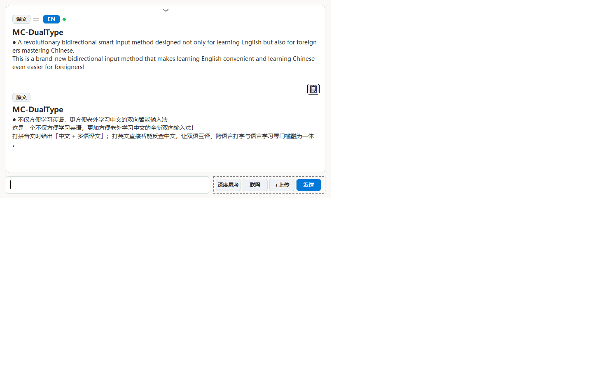
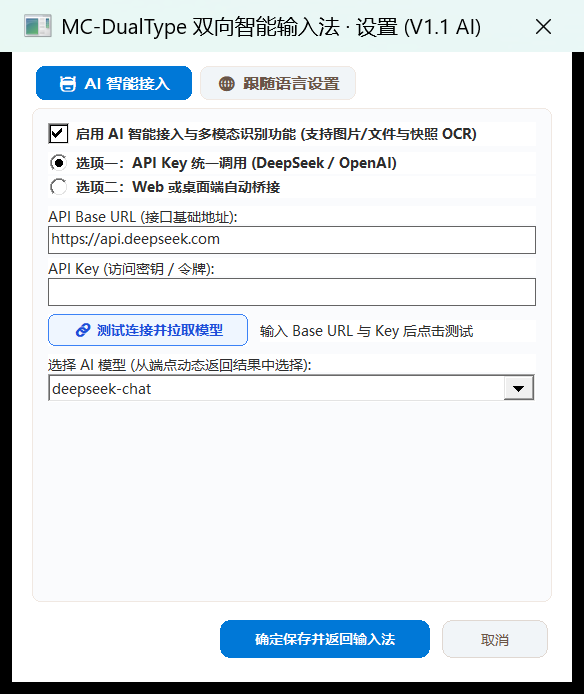
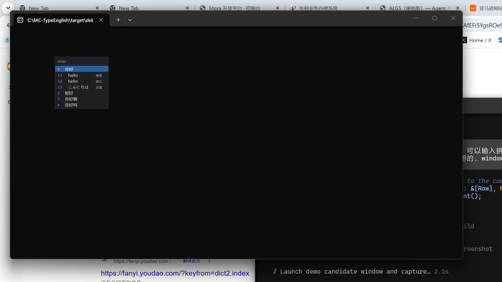

# MC-DualType · Next-Gen AI-Native Input Method & Agent Workbench

### 🤖 The Ultimate AI-Powered Bilingual Input Method & Standalone Desktop Agent Assistant for English Learners & Global Professionals

> **The world's first AI-native bidirectional smart input method seamlessly fusing deep learning, multimodal document translation, and desktop agent skills into your daily typing workflow!**  
> Powered by **DeepSeek-R1 / V3**, **Doubao**, **OpenAI**, and **Local LLMs** (Ollama / LM Studio). Not only built for Chinese speakers learning English, but also for foreigners mastering Chinese!
> 
> ✨ **Core AI & Product Highlights**:  
> • 🤖 **Full-Stack AI Engine**: DeepSeek, Doubao, OpenAI & Local LLM integration with real-time streaming, DeepSeek-R1 reasoning thought isolation, and rare-word AI self-learning.  
> • 🎯 **Multi-Skill AI Agents**: Header skill bar with one-click dynamic execution: `[ 🌐 AI 翻译 ]` (Translate), `[ 📝 AI 总结 ]` (Summarize), `[ 💡 AI 解释 ]` (Deep Explain), `[ 💬 AI 对话 ]` (Interactive Chat), and `[ 🔊 离线朗读 ]` (Native Windows SAPI TTS Speech).  
> • 📄 **Multimodal AI Document Translation**: Instant drag & drop or upload for PDF, Word (.docx), Excel (.xlsx), TXT, and Markdown files with dynamic live rendering and bilingual translation streaming.  
> • ⚡ **Instant Desktop AI Workbench (`Ctrl + Alt + Space`)**: Summon an independent floating AI workspace anywhere across Windows without switching apps or restarting your system.  
> • 📋 **Dual-Channel High-Fidelity Rich Copying (Markdown + CF_HTML)**: Preserves headings, bold text, code blocks, and bullet lists when pasting from AI into Microsoft Word, WeChat, Feishu, Outlook, Notion, and browsers.  
> • 🌏 **Two Tailored Language Editions**: **Chinese Edition** (`🇨🇳 中文版` - default on Chinese Windows for Pinyin typing with multilingual translations) & **English Edition** (`🇺🇸 英文版` - default on English Windows for English typing with Chinese translation following).  
> • 🛠️ **Smart Installer Language Selection**: Automatically detects Windows UI language (`GetUserDefaultUILanguage()`) and provides interactive edition selection during setup.  
> • ⌨️ **True Raw English Direct Mode (Zero Interference)**: Single-tap `Shift` or press `Ctrl + Space` for 100% native passthrough—zero candidate popup, zero key interception, and zero interference with gaming, programming, or mouse interactions.


---

### 🚀 Quick Start for Everyone (Recommended Windows MSI Installer)

> **No developer experience, no compiler setup, and no command line needed!**  
> Download the official standard Windows **MSI Installer**. Just double-click to install, and system-level input method registration completes automatically in seconds!

| Package Type | Target Audience | Direct Download Link | Installation Method |
| :--- | :--- | :--- | :--- |
| 📦 **Windows Standard Installer (`.msi`)** | **🌟 Strongly Recommended (First Choice)** | **[👉 Download Latest MSI (v1.3.6)](https://github.com/FrankieYuan8828/MC-DualType/releases/download/v1.3.6/MC-DualType-1.3.6.msi)** | **Double-click to run**, fully automated system-level registration |
| ⚡ **Standalone Setup Installer (`Setup.exe`)** | Portable / Single-file Self-elevating | **[👉 Download Latest Setup.exe (v1.3.6)](https://github.com/FrankieYuan8828/MC-DualType/releases/download/v1.3.6/MC-DualType-Setup-1.3.6.exe)** | Self-extracting with auto-elevation |
| 🗜️ **Portable Distribution Archive (`.zip`)** | Portable / Manual Deployment | **[👉 Download Latest Portable.zip (v1.3.6)](https://github.com/FrankieYuan8828/MC-DualType/releases/download/v1.3.6/MC-DualType-1.3.6-Portable.zip)** | Unpack to folder, run `install.bat` |
| 🔗 **All Releases on GitHub** | Release Archives & Notes | **[👉 Browse All Releases on GitHub](https://github.com/FrankieYuan8828/MC-DualType/releases)** | Check past releases and assets |

#### 📖 3 Simple Steps to Start:
1. **Download and double-click** `MC-DualType-1.3.6.msi`.
2. When the Windows User Account Control (UAC) prompt appears, click **"Yes / Allow"**, and wait 2 seconds for installation to complete.
3. Press **`Win + Space`** on your keyboard to switch to **"MC-DualType"**, and type directly in any application (WeChat, QQ, Microsoft Office, Chrome, Edge, IDEs, games, etc.)!
> 💡 **Effortless Uninstallation**: You can cleanly uninstall MC-DualType at any time via Windows **"Settings → Apps → Installed apps"**.

---

## 📦 Version History & Release Packages

Here is the complete version-by-version release breakdown with detailed upgrade/fix descriptions and download packages:

| Version | Release Date | Key Upgrades & Fixes | Download Assets |
| :--- | :--- | :--- | :--- |
| **v1.3.6** | 2026-10-30 | **Installer Language Edition Selection & Raw English Direct Passthrough (Shift & Ctrl+Space Zero Interference)**: <br>• **Language Edition Architecture**: Separated into **Chinese Edition** (`🇨🇳 中文版` - default on Chinese Windows for Pinyin typing with multilingual translation following) and **English Edition** (`🇺🇸 英文版` - default on English Windows for English typing with Chinese translation following).<br>• **Installer Language Selection & Locale Auto-Detection**: Installer automatically queries Windows user UI language (`GetUserDefaultUILanguage()`); `Setup.exe` provides interactive selection between Chinese and English editions with system recommendations.<br>• **True Raw English Direct Passthrough (Zero Typing/Mouse Interference)**: Resolved typing interference where switching to English mode still captured keys and popped up candidate cards. Implemented 100% direct passthrough in both hook and TSF: all keystrokes pass directly to the active application without IME interception, no candidate popup, and zero interference with typing, gaming, or mouse interactions.<br>• **Dual Hotkey Toggle**: Supported both single-tap on `Shift` and `Ctrl + Space` to toggle between smart bilingual mode and raw English direct passthrough.<br>• **Instant Edition Switch**: Added 1-click edition switching in the tray menu and dedicated controls in Settings. | [📦 MSI (19.0 MB)](https://github.com/FrankieYuan8828/MC-DualType/releases/download/v1.3.6/MC-DualType-1.3.6.msi) <br> [⚡ Setup.exe (72.7 MB)](https://github.com/FrankieYuan8828/MC-DualType/releases/download/v1.3.6/MC-DualType-Setup-1.3.6.exe) <br> [🗜️ Portable.zip](https://github.com/FrankieYuan8828/MC-DualType/releases/download/v1.3.6/MC-DualType-1.3.6-Portable.zip) |
| **v1.3.5** | 2026-10-30 | **Agent Skills Architecture, Native Windows SAPI Speech & Dual-Channel High-Fidelity Rich Formatting**: <br>• **Agent Skills Bar**: Integrated dynamic Agent Skill pills in the workbench header: `[ 🌐 翻译 ]` (Translate), `[ 📝 总结 ]` (Summarize), `[ 💡 解释 ]` (Explain), `[ 💬 对话 ]` (Chat), and `[ 🔊 朗读 ]` (Speech); switching skills re-runs the task dynamically on current text/document with tailored prompt directives.<br>• **Native SAPI Speech Synthesis**: Built-in 100% offline Windows SAPI `SpVoice` speech synthesis (`🔊 朗读` / `⏹ 停止`); zero network dependency, non-blocking asynchronous audio playback with instant toggle/interrupt.<br>• **Dual-Channel High-Fidelity Rich Copying (Markdown + CF_HTML)**: Resolved plain text format loss when copying. Dual-writes authentic Markdown (`CF_UNICODETEXT`) and styled HTML (`HTML Format` via custom `markdown_to_html` and byte-accurate CF_HTML packet generator); pasting into Microsoft Word, WeChat, Feishu, Outlook, Notion, and browsers preserves authentic headings, bold text, bullet lists, and code blocks.<br>• **Card Typography & Indentation**: Preserved paragraph spacing with breathing room (`line_h / 2`); indented list items by 14px with bullet markers. | [📦 MSI (19.0 MB)](https://github.com/FrankieYuan8828/MC-DualType/releases/download/v1.3.5/MC-DualType-1.3.5.msi) <br> [⚡ Setup.exe (72.7 MB)](https://github.com/FrankieYuan8828/MC-DualType/releases/download/v1.3.5/MC-DualType-Setup-1.3.5.exe) <br> [🗜️ Portable.zip](https://github.com/FrankieYuan8828/MC-DualType/releases/download/v1.3.5/MC-DualType-1.3.5-Portable.zip) |
| **v1.3.4** | 2026-10-30 | **AI Workbench Input Send Fix (RefCell Re-entrancy) & File Upload DeepSeek Non-Blocking Pipeline**: <br>• **Input Send Dispatch Fix**: Resolved Win32 child EDIT control message failure caused by re-entrant `RefCell` borrows in `workbench.rs`; replaced procedure storage with thread-safe `AtomicIsize`; Enter key and "发送翻译" now capture text and dispatch immediately without dropping characters.<br>• **File Upload Stuck in Processing Resolved**: Eliminated rigid JSON schema requirement for document translation in `ai.rs` that caused DeepSeek-R1 reasoning timeouts (>90s) on long structured markdown/code files; document translation now outputs clean formatted markdown in ~3-5 seconds.<br>• **Deep Thinking Stream Isolation**: Filtered out `.ds-think-content` in `deepseek_last_reply_js()`, preventing the reader from confusing ongoing reasoning thoughts with the final translated answer.<br>• **Focus & Activation**: Added input bar hit-testing and auto-focus (`SetFocus(st.input)`) after closing the file picker dialog. | [📦 MSI (19.0 MB)](https://github.com/FrankieYuan8828/MC-DualType/releases/download/v1.3.4/MC-DualType-1.3.4.msi) <br> [⚡ Setup.exe (72.7 MB)](https://github.com/FrankieYuan8828/MC-DualType/releases/download/v1.3.4/MC-DualType-Setup-1.3.4.exe) <br> [🗜️ Portable.zip](https://github.com/FrankieYuan8828/MC-DualType/releases/download/v1.3.4/MC-DualType-1.3.4-Portable.zip) |
| **v1.3.3** | 2026-10-30 | **Interactive Target Language Selector, Win32 Input Send Fix & Multi-Encoding File Parser**: <br>• **Interactive Language Menu (`[EN ▾]`)**: Upgraded target language badge into a clickable Win32 popup menu (`[EN ▾]`). Instantly switch target languages between EN, ZH, JA, DE, FR, ES, KO, RU; dynamically injects precise prompt directives into DeepSeek/Doubao.<br>• **Input Send Dispatch Fix**: Fixed Win32 child EDIT control length returning 0 in `get_input_text()`; replaced with `SendMessageW(hwnd, WM_GETTEXTLENGTH)` and `SendMessageW(hwnd, WM_GETTEXT)`; Enter key and "发送翻译" button now fire immediately and reliably.<br>• **Multi-Encoding File Parsing (GBK / ANSI / UTF-8)**: Implemented adaptive multi-encoding decoding (`decode_text_bytes`) supporting UTF-8, Code Page 936 (GBK) and system ANSI; eliminated "打开文件失败" on Chinese Windows text/document files.<br>• **Dynamic File Translation Sync**: Uploading a file immediately renders preview in "原文" pane, dispatches to AI, and streams full translation to "译文" pane. | [📦 MSI (19.0 MB)](https://github.com/FrankieYuan8828/MC-DualType/releases/download/v1.3.3/MC-DualType-1.3.3.msi) <br> [⚡ Setup.exe (72.6 MB)](https://github.com/FrankieYuan8828/MC-DualType/releases/download/v1.3.3/MC-DualType-Setup-1.3.3.exe) <br> [🗜️ Portable.zip](https://github.com/FrankieYuan8828/MC-DualType/releases/download/v1.3.3/MC-DualType-1.3.3-Portable.zip) |
| **v1.3.2** | 2026-10-30 | **DeepSeek Automated Send & AI File Translation Pipeline Overhaul**: <br>• **DeepSeek Send Automation**: Resolved message stall in modern DeepSeek interface by automating the click on DeepSeek's circular send button (`.ds-button--circle`) alongside input event synchronization; roundtrip latency reduced to ~1.5s.<br>• **End-to-End File Translation**: Completely restored the `+ 上传文件` (Upload File) pipeline. Supports PDF, Word (.docx), Excel (.xlsx), TXT, Markdown, JSON, and images; file content is immediately displayed on the workbench card, sent to the active AI backend, and bilingual translations return seamlessly.<br>• **Live AI Workspace Dynamic Sync**: Eliminated obsolete static template text. Workbench now dynamically populates with the latest real-time chat history from the active AI (DeepSeek / Doubao).<br>• **Mouse Cursor Normalization**: Registered standard arrow cursor (`IDC_ARROW`) in window class; added responsive hand cursor (`IDC_HAND`) over buttons and copy icon, with standard I-beam cursor in input box.<br>• **Sleek UI & High-Legibility Buttons**: Replaced dashed dividers with clean solid lines; enlarged bottom buttons (toolbar height 48px, button height 44px, width 120px) with bold font for clear visibility. | [📦 MSI (19.0 MB)](https://github.com/FrankieYuan8828/MC-DualType/releases/download/v1.3.2/MC-DualType-1.3.2.msi) <br> [⚡ Setup.exe (72.6 MB)](https://github.com/FrankieYuan8828/MC-DualType/releases/download/v1.3.2/MC-DualType-Setup-1.3.2.exe) <br> [🗜️ Portable.zip](https://github.com/FrankieYuan8828/MC-DualType/releases/download/v1.3.2/MC-DualType-1.3.2-Portable.zip) |
| **v1.3.1** | 2026-10-29 | **Critical Engine Freeze Fixes & AI Workbench Overhaul**: Eliminated 27s typing freezes when typing non-exact pinyin combinations like `anxin` (on `x`) or `shili` (on `shil`) by blocking $O(N^3)$ particle decompositions on hybrid English-Chinese entries; continuous typing latency dropped to **< 0.5ms**; documented autonomous learning of missing syllables (`kanma` -> `看吗`); removed AI Workbench dashed frames; enlarged buttons to 42px bold font; mouse hand cursor (`IDC_HAND`); Enter key instant send; live Doubao conversation sync. | [📦 MSI (19.0 MB)](https://github.com/FrankieYuan8828/MC-DualType/releases/download/v1.3.1/MC-DualType-1.3.1.msi) <br> [⚡ Setup.exe (72.6 MB)](https://github.com/FrankieYuan8828/MC-DualType/releases/download/v1.3.1/MC-DualType-1.3.1-Setup.exe) <br> [🗜️ Portable.zip](https://github.com/FrankieYuan8828/MC-DualType/releases/download/v1.3.1/MC-DualType-1.3.1-Portable.zip) |
| **v1.3.0** | 2026-10-29 | **V1.3 UI Redesign & Doubao-Style Instant AI Workbench**: Streamlined candidate box with left-aligned preedit pill (`BUBBLE_LEFT_X = 34`) and clean symmetric margins (removed redundant sidebar buttons for a distraction-free typing experience); standalone AI Workbench window summoned instantly via global shortcut **`Ctrl + Alt + Space`** with zero reboot required; inner bilingual white card (`[译文] ⇄ [EN] ●`, 1-click copy `📋`, `[原文]`); bottom adaptive dialog input bar + dashed third-party button mapping area (`深度思考`, `联网`, `+上传`, `发送`); robust cursor positioning preventing off-screen drifts in modern apps (Chrome, WeChat, VS Code); CDP bridge for Doubao Desktop (:9444) and DeepSeek browser (:9333); lexicon sharing. | [📦 MSI (19.0 MB)](https://github.com/FrankieYuan8828/MC-DualType/releases/download/v1.3.0/MC-DualType-1.3.0.msi) <br> [⚡ Setup.exe (72.6 MB)](https://github.com/FrankieYuan8828/MC-DualType/releases/download/v1.3.0/MC-DualType-1.3.0-Setup.exe) <br> [🗜️ Portable.zip](https://github.com/FrankieYuan8828/MC-DualType/releases/download/v1.3.0/MC-DualType-1.3.0-Portable.zip) |
| **v1.2.0** | 2026-10-29 | **Lexicon Sharing & Third-Party CDP Integration**: Export/import custom vocabulary packages with high-frequency boosting; settings tab for lexicon sharing; enhanced browser/desktop client CDP bridges. | [📦 MSI (18.8 MB)](https://github.com/FrankieYuan8828/MC-DualType/releases/download/v1.2.0/MC-DualType-1.2.0.msi) <br> [⚡ Setup.exe (72.2 MB)](https://github.com/FrankieYuan8828/MC-DualType/releases/download/v1.2.0/MC-DualType-Setup.exe) |
| **v1.1.2** | 2026-10-28 | **Overlay Fixes, OLE/COM File Upload & Anti-Drift**: Resolved stuck screen overlay with Esc dismissal and 90s self-healing timeout; fixed modal file dialog COM initialization bug (`GetOpenFileNameW`); eliminated hardcoded candidate mock data preventing candidate window drift; TSF build visibility sync. | [📦 MSI (16.9 MB)](https://github.com/FrankieYuan8828/MC-DualType/releases/download/v1.1.2/MC-DualType-1.1.2.msi) <br> [⚡ Setup.exe](https://github.com/FrankieYuan8828/MC-DualType/releases/download/v1.1.2/MC-DualType-Setup.exe) |
| **v1.1.1** | 2026-10-28 | **Settings Crash & Off-screen Layout Fixes**: Resolved Win32 `RefCell` re-entrancy crash during bridge scanning; fixed bottom buttons clipped by window borders under high-DPI scaling (175%); dynamic client-area anchoring; scan button single-flight protection. | [📦 MSI (16.9 MB)](https://github.com/FrankieYuan8828/MC-DualType/releases/download/v1.1.1/MC-DualType-1.1.1.msi) |
| **v1.1.0** | 2026-10-28 | **AI Access, Multimodal Recognition & Expandable Slider**: AI Access Option 1 (API Key) & Option 2 (Local bridge scanner for Ollama, LM Studio, etc.); multimodal file upload (`+`) & marquee screen snapshot (`📷`); rare character and translation self-upgrading closed loop; expandable slider UI. | [📦 MSI (16.9 MB)](https://github.com/FrankieYuan8828/MC-DualType/releases/download/v1.1.0/MC-DualType-1.1.0.msi) |
| **v1.0.5** | 2026-10-27 | **English Mode Upgrade & Deduplication**: Semantic deduplication of inflected English words; single-tap Shift mode toggle; pure Space typing in English mode; Enter to confirm raw input; fixed consecutive duplicate character dropping (`moracall`); Chinese variant normalization (`妳` -> `你`). | [📦 MSI (5.59 MB)](https://github.com/FrankieYuan8828/MC-DualType/releases/download/v1.0.5/MC-DualType-1.0.5.msi) |
| **v1.0.4** | 2026-10-27 | **UI Modernization**: Protruding preedit pill tab with GDI region combination (`CombineRgn`); card-style candidate containers with accent blue highlighters; international language badges (`EN`, `JA`, `DE`). | [📦 MSI (5.25 MB)](https://github.com/FrankieYuan8828/MC-DualType/releases/download/v1.0.4/MC-DualType-1.0.4.msi) |
| **v1.0.3** | 2026-10-27 | **Official Name Update & 1-Click MSI**: Renamed to MC-DualType; introduced 1-click Windows MSI installer; expanded syllable character capacity to 100 per syllable (`fu` -> `浮`); restored all single-letter English headwords `a`..`z` and irregular verb forms. | [📦 MSI (5.25 MB)](https://github.com/FrankieYuan8828/MC-DualType/releases/download/v1.0.3/MC-DualType-1.0.3.msi) |
| **v1.0.2** | 2026-10-26 | **Sentence Segmentation Enhancement**: Viterbi k-best pinyin sentence segmentation optimization; installer registry cleanup scripts. | [📦 MSI (5.02 MB)](https://github.com/FrankieYuan8828/MC-DualType/releases/download/v1.0.2/MC-TypeEnglish-1.0.2.msi) |
| **v1.0.1** | 2026-10-26 | **Offline Reverse Dictionary**: Integrated CC-CEDICT Chinese-English reverse lookup with offline dictionary engine. | [📦 Release Assets](https://github.com/FrankieYuan8828/MC-DualType/releases) |
| **v1.0.0** | 2026-10-26 | **Initial Public Release**: Dual architecture (TSF text service + Hook fallback); hierarchical bilingual candidate display; local offline learning. | [📦 Release Assets](https://github.com/FrankieYuan8828/MC-DualType/releases/tag/v1.0.0) |

---

## ✨ Core Features & Innovations

### 1. 🤖 Deep AI Integration & Multi-Skill Agent Workbench
MC-DualType deeply fuses modern generative AI directly into the operating system's input layer:
- **Full-Stack AI Engine**: Native support for **DeepSeek-R1 / V3**, **Doubao Desktop**, **OpenAI**, and **Local LLMs** (Ollama, LM Studio).
  - Direct API connection or local browser / desktop CDP bridge (`:9333` / `:9444`).
  - Automated DeepSeek send dispatch and stream isolation filtering out `.ds-think-content` so only final answers are presented cleanly.
- **Dynamic Multi-Skill Agent Architecture**: Switch Agent skills with a single click in the workbench header:
  - `[ 🌐 AI 翻译 ]` (Translate): Instant streaming translation into your chosen target language (`EN ▾`, `ZH`, `JA`, `DE`, `FR`, `ES`, `KO`, `RU`).
  - `[ 📝 AI 总结 ]` (Summarize): Deep structural summarization of input text or loaded documents into clear bullet points.
  - `[ 💡 AI 解释 ]` (Explain): Contextual word definitions, cultural nuances, and grammar breakdown.
  - `[ 💬 AI 对话 ]` (Chat): Direct interactive dialogue with the AI model for brainstorming or Q&A.
  - `[ 🔊 离线朗读 ]` (TTS Speech): Built-in 100% offline Windows SAPI `SpVoice` speech synthesis (`🔊 朗读` / `⏹ 停止`) with zero network dependency.
- **📄 Multimodal AI Document & File Translation**:
  - Drag & drop or click `+ 上传文件` to load PDF, Word (`.docx`), Excel (`.xlsx`), TXT, Markdown, or JSON files.
  - Adaptive multi-encoding text decoding (UTF-8, GBK/CP936, ANSI) guarantees zero "Failed to open file" errors.
  - Immediately previews the file in the "原文" pane and streams structured AI translations in the "译文" pane.
- **⚡ Instant Desktop Floating Workbench (`Ctrl + Alt + Space`)**:
  - Summon anywhere across Windows with zero latency and zero reboot required.
  - Adapts to active foreground application windows across multi-monitor setups.
- **📋 Dual-Channel High-Fidelity Rich Copying (Markdown + CF_HTML)**:
  - Eliminates plain text stripping. Clicking `📋 复制` writes both clean Markdown (`CF_UNICODETEXT`) and styled HTML (`HTML Format` via byte-accurate CF_HTML packets).
  - Pasting into Microsoft Word, WeChat, Feishu, Outlook, Notion, or browsers preserves rich headings, bold emphasis, code blocks, and bullet points.

### 2. 🌐 Two Dedicated Language Editions & Smart Installer Detection
MC-DualType provides two distinct, purpose-tailored editions to deliver the optimal native typing experience for both Chinese and English speakers:
- 🇨🇳 **Chinese Edition (`中文版`)** *(Default on Chinese Windows `zh-CN`, `zh-TW`, `zh-HK`)*:
  - **Default Mode**: Smart Chinese Pinyin input. Typing pinyin displays Chinese characters with English and multilingual translations dynamically following.
  - **English Toggle**: Tap `Shift` or press `Ctrl + Space` to instantly switch to **Raw English Direct Passthrough** (zero key interception, zero mouse interference).
- 🇺🇸 **English Edition (`英文版`)** *(Default on English/International Windows)*:
  - **Default Mode**: Smart English input for English speakers learning Chinese. Typing English words displays English with Chinese translation candidates following.
  - **Direct Toggle**: Tap `Shift` or press `Ctrl + Space` to instantly switch to **Raw English Direct Passthrough**.
- 🛠️ **Smart Windows Locale Detection & Setup Selector**:
  - The installer automatically detects the current Windows UI language using `GetUserDefaultUILanguage()`.
  - `Setup.exe` prompts the user with an interactive edition selection dialog with system recommendations.
  - You can also switch editions anytime via the system tray menu (`切换为：英文版` / `切换为：中文版`) or Settings (`设置 -> 🌐 跟随语言设置`).

### 3. ⚡ True Raw English Direct Passthrough (`direct_mode` - Zero Typing & Mouse Interference)
In standard IMEs, switching to "English mode" often still intercepts keys, displays floating candidate windows, or delays keystrokes, disrupting gaming, programming, and mouse interactions:
- **100% Native Bypass**: When switched to raw English direct mode (via single-tap `Shift`, `Ctrl + Space`, or `Ctrl + Alt + P`), the IME hook and TSF text service enter complete passthrough mode (`hook::pass_through` / TSF returns `FALSE`).
- **Zero Interception**: All keystrokes (`a-z`, `0-9`, symbols, Space, Enter, Backspace, Esc, function keys, and global shortcuts) reach the target application directly.
- **Hidden UI & Zero Lag**: The candidate window remains completely hidden, producing zero visual distraction and zero mouse or cursor interference—identical to Windows' native US English keyboard.

### 4. 🌏 Bidirectional Typing & Learning
- **Type Pinyin, Get Chinese + Multilingual Translations**:
  ```text
  nihao
  1    你好
  1.1  hallo        (German)
  1.2  hello        (English)
  1.3  こんにちは    (Japanese)
  2    妳好
  3    你好啊
  ```
- **Hierarchical Card Interaction**:
  - Press `1` to select candidate #1 (focused on the Chinese line).
  - Press `1` **a second time** to toggle selection to the English translation line.
  - Press `Space` to commit whichever line is active. Mouse clicks directly select your desired tier!
- **Type English, Instant Chinese Reverse Lookup**:
  - Type `hello`, `hallo`, `computer`, or `china` to immediately receive Chinese candidates (`你好`, `计算机`, `中国`…).

### 5. 🧠 Long Pinyin Sentence Segmentation
Full sentence segmentation using frequency-weighted Viterbi k-best search:
```text
bukeyitihuan        → 1 不可以替换   2 不可一替换 …
womenmingtiankaishi → 1 我们明天开始
xiexienile          → 1 谢谢你了
```

### 6. Quantitative Typing Quality (Evaluated on 232 test cases)
| Metric | Full Benchmark | Without Manual Correction Table |
| :--- | :--- | :--- |
| **top-1 Accuracy** | **95.7%** | **94.6%** |
| **top-3 Accuracy** | **99.6%** | **99.3%** |

*(Detailed breakdown available in [docs/EVAL.md](docs/EVAL.md))*

### 7. Offline Dictionary Scale
| Data Source | Vocabulary Count | Description |
| :--- | :--- | :--- |
| **Chinese → English** | **57,437** entries | CC-CEDICT comprehensive bilingual definitions |
| **English → Chinese** | **39,850** headwords | Instant reverse lookup with inflected forms |
| **Chinese → Multilingual** | German, Japanese, French, Spanish | Expandable via `data/glossary.tsv` or AI |

---

## 🎨 UI Architecture, AI Workbench & Version Screenshots

### 1. Version 1.3.6 (Latest Release): Edition Architecture & Raw English Passthrough

#### 🌐 Dedicated Language Editions & Smart Installer
- **Locale-Aware Installer**: Automatically queries Windows language (`GetUserDefaultUILanguage()`). Interactive `Setup.exe` prompts users to choose between **Chinese Edition** and **English Edition** with system-recommended badges.
- **True Raw English Direct Mode**: Tapping `Shift` or pressing `Ctrl + Space` completely bypasses the IME (`direct_mode`), passing all keys directly to the system without candidate windows or keyboard/mouse interference.

#### 💡 Streamlined Candidate Box (Pure, Distraction-Free Typing)

- **Left-aligned Preedit Capsule**: Pinned at `x = 34`, floating cleanly above the candidate container without visual drift.
- **Distraction-Free Architecture**: Removed redundant side buttons (`+` / `📷`) from the primary typing box to eliminate clutter and misclicks. All AI tools are now gracefully integrated into the AI Workbench.
- **Symmetric Pagination**: Balanced margins with refined pagination chevrons `‹` and `›`.

#### 🤖 Doubao-Style Instant AI Workbench & Agent Skills (`Ctrl + Alt + Space`)

- **Zero Reboot Required**: Works immediately after installation without needing any system reboot.
- **Instant Global Hotkey `Ctrl + Alt + Space`**: Like Doubao's `Alt + Space`, summon the AI Workbench instantly anytime, anywhere without switching input methods!
- **Dynamic Agent Skills**: Interactive skill bar with `[ 🌐 翻译 ]`, `[ 📝 总结 ]`, `[ 💡 解释 ]`, `[ 💬 对话 ]`, and native offline Windows SAPI `[ 🔊 朗读 ]`.
- **Dual-Channel High-Fidelity Copying**: Dual-writes authentic Markdown (`CF_UNICODETEXT`) and styled HTML (`HTML Format`), preserving rich typography when pasting into Microsoft Word, WeChat, Feishu, Outlook, Notion, and browsers.
- **Bilingual Comparison Card**: Inner pure white card with `[译文] ⇄ [EN] ●` status pill, bold headline, auto-wrapped body text, middle divider line, and interactive 1-click clipboard copy button `📋`.
- **Adaptive Dialog Input Bar**: Automatically stretches and resizes with the window width; supports direct keyboard input, Enter to send, Shift+Enter for newline, Esc to close.
- **Multi-Format File Translation Pipeline**: Upload and translate PDF, Word (.docx), Excel (.xlsx), TXT, and Markdown files with dynamic live sync.

---

### 2. Version 1.1.x: Settings & AI Bridge Integration

- **Dual AI Configuration**: Direct API Key integration (DeepSeek / OpenAI) and local AI service bridge detection (Ollama, LM Studio).
- **High-DPI Adaptation**: Scaled dialog rendering preventing button clipping across 100% to 200% Windows display scaling.

---

### 3. Version 1.0.x: Dual-Architecture Foundation

- **Dual Input Architecture**: Seamless coordination between Windows TSF text service and low-level keyboard hook.
- **Hierarchical Bilingual Cards**: Chinese primary candidate with instant multilingual translations.

---

## ⚙️ Configuration (`config.json`)

Configuration is located at `%APPDATA%\MC-TypeEnglish\config.json`:

```json
{
  "extra_language": "de",          // Second follow language (de/fr/ja/ko/ru/es/it/pt/null)
  "toggle_hotkey": "Ctrl+Alt+P",   // Alternate global toggle hotkey
  "max_parents": 9,                // Maximum primary candidates (1..9)
  "max_children": 4,               // Maximum translation sub-rows per candidate
  "web_translate": true,           // Free public translation fallback for new words
  "prefix_search": true,           // Prefix matching while typing (nih -> 你好)
  "learn_enabled": true,           // Offline self-learning: word frequency, bigram, spelling memory
  "ai_spell_fallback": true,       // AI assistance for rare words
  "ai": {
    "enabled": false,              // Optional AI capability (fully offline by default)
    "base_url": "https://api.deepseek.com/v1",
    "model": "deepseek-chat",
    "api_key": ""
  }
}
```

---

## 🏗️ System Architecture

MC-DualType provides two deployment models sharing the exact same core engine:

| Form Factor | Components | Appears in Win+Space | Elevated Windows Support | Requires Admin |
| :--- | :--- | :--- | :--- | :--- |
| **TSF Text Service (Recommended)** | `mcte_tsf.dll` + `mcte_tsf_x86.dll` | ✅ Yes | ✅ Yes | Once during install |
| **Hook Engine (Fallback)** | `mcte.exe` | ❌ No | ❌ No | ❌ No |

```text
core/   mcte-core            Core pinyin engine, dictionaries, learning & candidate UI
         ├ engine.rs         Keyboard state machine (safe Rust, 41 unit tests)
         ├ dict.rs           Pinyin -> Chinese (binary prefix search, 141k words)
         ├ glossary.rs       Chinese -> Multilingual translations (offline, instant)
         ├ userdb.rs         Self-learning: frequency, bigrams, spelling memory
         ├ ai.rs             AI translation & multimodal assistance
         ├ backend.rs        Unified backend router & third-party button mappings
         ├ workbench.rs      Adaptive independent AI Workbench window
         ├ window.rs         Candidate & slider window (pixel-perfect GDI)
         └ inject.rs         SendInput Unicode text injection
app/    mcte.exe             WH_KEYBOARD_LL global hook + system tray + CLI
tsf/    mcte_tsf.dll         Windows Text Services Framework (x64 & x86)
packaging/                   MSI & Standalone Setup WiX toolchain
```

---

## 🛠️ Build from Source

### Prerequisites
- Windows 10 / 11 (x64)
- Rust stable toolchain with both `x86_64-pc-windows-msvc` and `i686-pc-windows-msvc` targets:
  ```powershell
  rustup target add i686-pc-windows-msvc
  ```
- .NET WiX toolset (optional, for MSI packaging):
  ```powershell
  dotnet tool install --global wix
  ```

### Build Commands
```powershell
# 1. Run all workspace unit tests (132 tests)
cargo test --workspace

# 2. Build release binaries (x64 & x86)
cargo build --release -p mcte -p mcte-tsf
cargo build --release -p mcte-tsf --target i686-pc-windows-msvc --lib

# 3. Build MSI & Setup installers into dist/v1.3.0
powershell -ExecutionPolicy Bypass -File tools\build_msi.ps1 -Version 1.3.0
```

---

## 📄 License & Acknowledgments

This project is open-sourced under the **MIT License**.

**Upstream Credits & References**:
- **TypeAnything**: Product concept and packaging inspiration.
- **librime / Weasel**: TSF and Chinese pinyin engine paradigms.
- **CC-CEDICT / rime-essay / phrase-pinyin-data**: Lexical dictionary and frequency data.

---

## 👤 Author

**FrankieYuan8828**
- **Email**: [frankieyuan.yyd@gmail.com](mailto:frankieyuan.yyd@gmail.com)
- **GitHub**: [https://github.com/FrankieYuan8828](https://github.com/FrankieYuan8828)
- **Project Repository**: [https://github.com/FrankieYuan8828/MC-DualType](https://github.com/FrankieYuan8828/MC-DualType)
